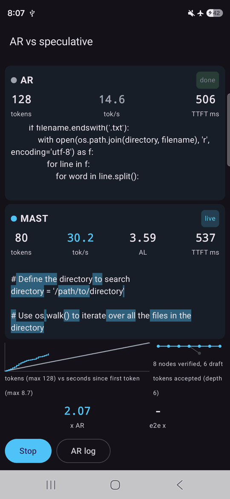
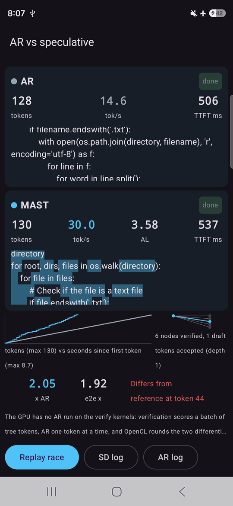
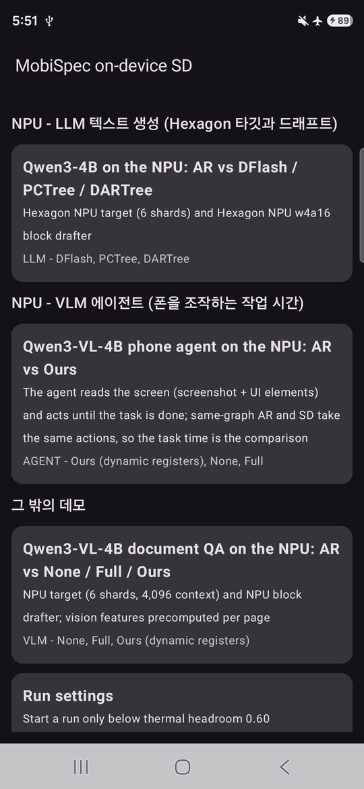
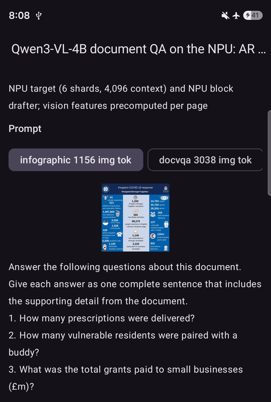
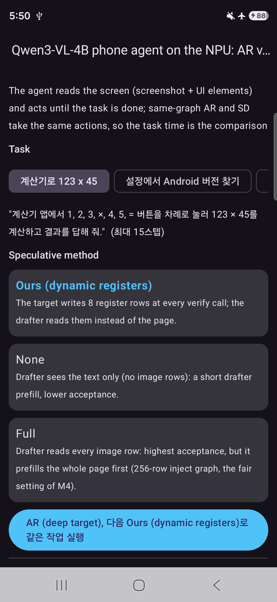
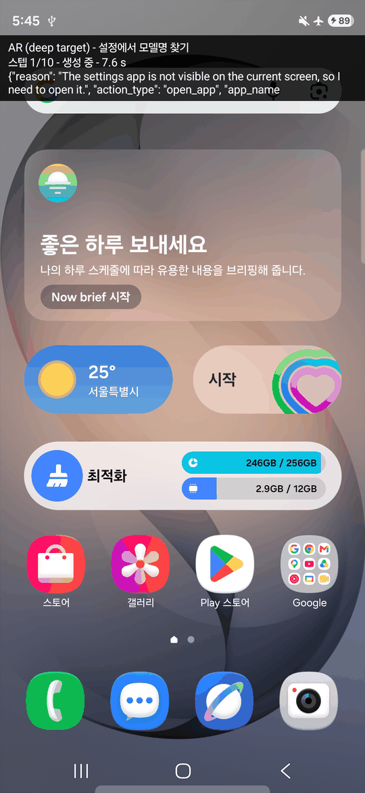
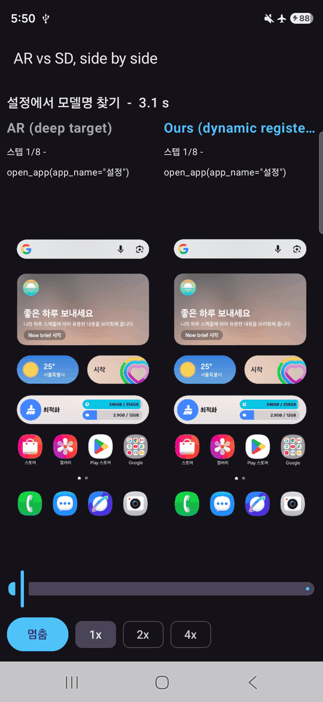

# Demo_MobiSpec.cpp

MobiSpec.cpp의 온디바이스 추측 디코딩(SD)을 Galaxy S26에서 보여 주는 Android 데모 앱이다.
앱은 실험에 쓰는 C++ 드라이버를 그대로 자식 프로세스로 실행한다.
- **LLM:** AR과 SD를 실시간 텍스트와 수치(tok/s, AL, x AR)로 나란히 비교한다.
- **VLM:** 에이전트가 폰을 직접 조작해 끝낸 작업 시간을 비교한다.

| 분류 | 모델 | 비교 |
|---|---|---|
| GPU · LLM (Adreno 타깃 + Adreno 드래프트) | Vicuna-7B (예비: Llama-3-8B) | AR vs MAST |
| NPU · LLM (Hexagon 타깃 + Hexagon 드래프트) | Qwen3-4B | AR vs DFlash / PCTree / DARTree |
| NPU · VLM 에이전트 | Qwen3-VL-4B가 스크린샷과 화면 요소를 보고 폰을 조작한다 | AR vs Ours (같은 행동, 작업 시간) |
| NPU · VLM 문서 QA (그 밖의 데모) | Qwen3-VL-4B, 문서 프리셋 5장 | AR vs None / Full / Ours |

## 화면

Galaxy S26에서 찍었다. 첫 줄의 레이스는 GPU 시나리오(Vicuna-7B, AR vs MAST, Spec-Bench coding 질문)이다.

| 레이스 진행 중 | 레이스 종료 | 홈 | VLM 프리셋 |
|---|---|---|---|
|  |  |  |  |
| AR(위)을 먼저 돌리고, MAST(아래)가 디코딩하는 중이다. 음영은 드래프트가 맞힌 토큰이고, 오른쪽 아래는 방금 검증한 트리다. | 두 실행의 x AR과 e2e 배수가 나온다. GPU에서는 MAST 텍스트가 AR과 달라지는 위치와 그 이유도 함께 보여 준다. | 홈의 분류. 위에서부터 GPU · LLM, NPU · LLM, NPU · VLM 에이전트, 그 밖의 데모(사진은 NPU부터) | 미리 계산해 둔 문서 페이지와 질문을 고른다. |

| 에이전트 시나리오 | 에이전트 실행 중 | 나란히 재생 |
|---|---|---|
|  |  |  |
| 태스크와 SD 기법을 고르면 같은 작업을 AR, 다음 SD로 한 번씩 실행한다. | 에이전트가 다른 앱을 조작하는 동안 위쪽 띠(HUD)에 기법, 스텝, 진행 단계, 생성 중인 답이 보인다. 띠는 터치를 막지 않고 모델 입력에도 들어가지 않는다. | 두 실행의 화면을 기록된 시간대로 함께 재생한다. 먼저 끝난 쪽이 멈추고 다른 쪽은 계속 간다. |

## 구성

경로는 MobiSpec.cpp 체크아웃과 같다. MobiSpec.cpp 트리 위에 그대로 덮어 쓰고 패치를 적용해서 쓴다.

| 경로 | 내용 |
|---|---|
| `examples/mobispec-demo-android/` | 앱(Kotlin + Compose)과 도구. 빌드, 배치, adb 실행, 기기 점검, 에이전트 설명은 이 디렉터리의 README에 있다. |
| `common/mobispec-events.h` | 드라이버의 이벤트 스트림(JSON Lines). `MOBISPEC_EVENTS`가 없으면 아무것도 하지 않는다. |
| `common/mobispec-serve.h` | 상주 모드. `MOBISPEC_SERVE`가 있으면 드라이버가 모델을 한 번 띄우고, 한 줄에 요청 하나씩 받는다. 에이전트가 스텝마다 쓴다. |
| `patches/driver-demo-hooks.patch` | 드라이버 5개에 넣는 이벤트 훅, VLM 드라이버 2개의 상주 모드, 상주 중 비전 인코더 재사용(+120줄) |

## 패치의 기준

`patches/driver-demo-hooks.patch`는 SKKU-ESLAB/MobiSpec.cpp `34cb2d8ba`에, 2026-10-23 시점의 연구용 미커밋 변경을 더한 트리를 기준으로 한다.

| 파일 | 기준 blob | HEAD `34cb2d8ba`와 |
|---|---|---|
| `examples/simple-qnn/simple-qnn.cpp` | `9acb0366b26d` | 같다 |
| `examples/speculative-eagle-2/speculative-eagle-2.cpp` | `1f57d86d2d8d` | 같다 |
| `examples/speculative-eagle-mast/speculative-eagle-mast.cpp` | `ef2931bdf772` | 같다 |
| `examples/speculative-dflash-qnn-npu/speculative-dflash-qnn-npu.cpp` | `393d286a6fb4` | 연구 변경 포함 |
| `examples/speculative-dflash-qnn/vlm-run.cpp` | `bd794bf94633` | 연구 변경 포함 |
| `examples/speculative-dflash-qnn/vlm-prompt.cpp` | `acea2d13529b` | 연구 변경 포함 |
| `src/QNN/llm_decode_runner.h` | `cd931c0dbe33` | 연구 변경 포함 |

```sh
cd MobiSpec.cpp
cp -r ../Demo_MobiSpec.cpp/common ../Demo_MobiSpec.cpp/examples .
git apply ../Demo_MobiSpec.cpp/patches/driver-demo-hooks.patch
```

## 들어 있지 않은 것

- 네이티브 바이너리(`jniLibs/`): `tools/stage_jnilibs.py`가 빌드 트리에서 만든다.
- Qualcomm QNN 런타임 라이브러리: 라이선스 때문에 넣지 않는다. 기기의 QAIRT 2.44.0 사본을 pull해서 스테이징한다.
- 모델, QNN 컨텍스트 바이너리, mmproj: 앱은 폰의 `/data/local/tmp`에 있는 실험 사본을 직접 읽는다.
  에이전트용 Ours 드래프터(4,096행 컨텍스트)와 Q8_0 mmproj도 거기에 둔다.
- `demo-manifest.json`: `tools/gen_manifest.py`가 MobiSpec.cpp의 실험 기록과 `tools/agent_spec.py`(에이전트의 프롬프트와 태스크)로 만든다.

## 기기 점검 요약 (S26)

2026-10-23:

- 앱 프로세스에서 HTP(FastRPC)와 벤더 OpenCL이 모두 동작한다.
- 앱 실행과 adb 셸 실행을 12개 방법에서 비교했다. 모두 토큰 ID와 AL이 같았고, t/s 차이는 3.1% 이내였다.
- NPU의 SD 출력은 같은 검증 그래프의 AR과 토큰 단위로 같다.
- GPU에는 검증 커널로 도는 AR이 없어서, MAST 텍스트가 AR과 도중에 달라질 수 있다. 앱은 그 위치와 이유를 함께 표시한다.

2026-10-26, VLM 에이전트:

- 상주 모드로 받은 요청은 같은 입력의 1회 실행(`-f`에 `--no-escape`)과 토큰 ID와 AL이 같다.
  다른 요청 다음에 와도 같다(AR-deep, Ours). 비전 인코더는 GPU(OpenCL)에서 돌린다.
- SD 실행은 모든 스텝에서 같은 그래프의 AR과 토큰이 같다.
- 두 실행을 따로 돌리면 화면 렌더링 차이만으로 행동이 갈라졌다. 흐린 검색 바가 실행마다 다르게 그려졌다.
  그래서 SD 실행도 화면을 직접 관측하고 조작하지만, 모델 입력은 AR 실행의 같은 스텝 화면을 쓴다.
- VLM 드라이버 두 개를 동시에 상주시키면 폰이 재부팅됐다. 한 번에 하나만 띄운다.
- F16 mmproj에서는 가용 메모리가 부족해져 시스템이 앱을 종료했다. Q8_0 mmproj를 쓴다.
